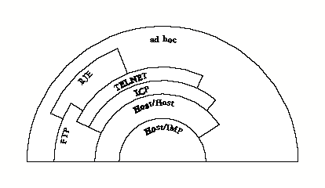
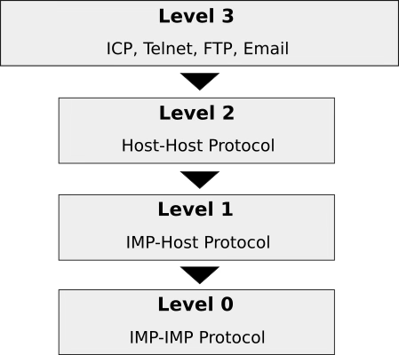
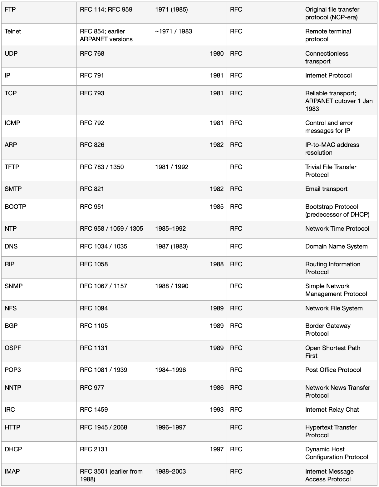
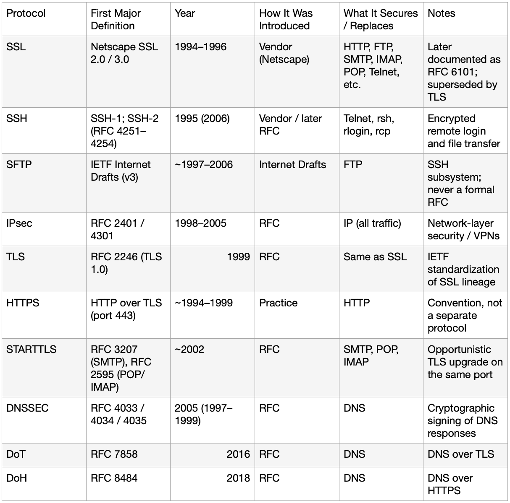
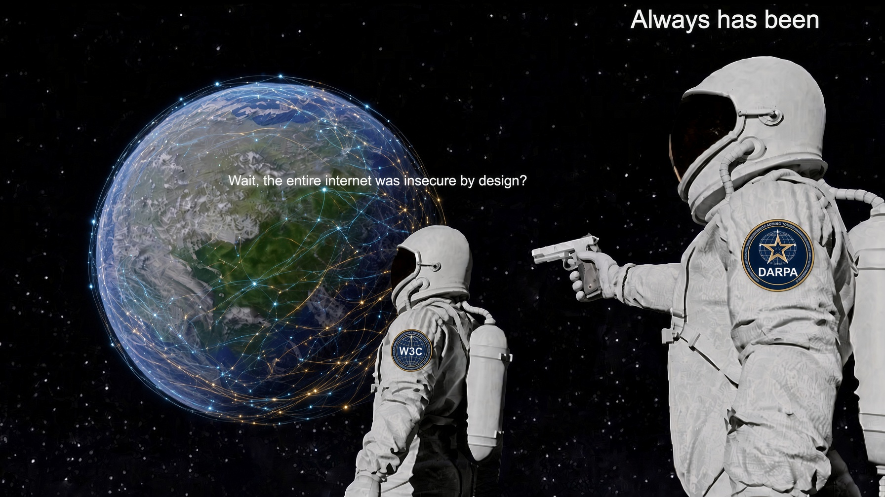

**Why do people get into cybersecurity?** It’s certainly not the work/life balance - in this field, continuous learning is a must: late nights, early mornings, and endless reading. Some go into this for the money - it’s not bad, but if you are smart, talented, and - more importantly - dedicated, then AI/ML, deep SWE, finance, management consulting, law, and other fields pay even more. So what is it? It’s *cool*. That’s why I got into cybersecurity - I wanted to be a *1337 H4XX0RZ*. I hacked into - legally and ethically, mind you - a lot of different computer systems. These are called CTF (Capture the Flag) challenges, and I have a YouTube channel where I actually walk you through how to do some of this stuff (see: YouTube.com/@frostsec). I went still further and got the OSCP (Offensive Security Certified Professional) - a certification which used to be (and somewhat still is) the de facto gold standard for being a *‘Pro Hacker’* (at least that’s what my HTB rank says...). 

Now why am I going on about this? Because I want the introduce the reader to something important: *hacking computers is a thing*. And then I’d like the reader to recognize the absurdity of the entire premise: *in what other industry is it accepted - and expected - that its end product be faulty, ridden with holes, and at risk of being disrupted, destroyed, or damaged by malicious threat actors?* To put it another way - *if computer systems and networks were built properly, cybersecurity would not be a thing!*

So... why is that the case? Why do we have so many vulnerabilities in computers and networks? That is what this article is about. I hope the reader comes to appreciate the subtle nuances and historical tradeoffs that have been made in designing and powering our modern internet.

## ARPANET

While the idea of computers goes back to Charles Babbage and Ada Lovelace, who first theorized a *computer programmer* -  later standardized and built out by Alan Turing and others for the war effort, the idea of networking computers, i.e. data communications involving distributed systems powered by computers, began as a slow drip, gradually culminating in what we may tentatively point to as the first computer network. First, we had large mainframe machines and time sharing. These were largely academic installations focused on helping graduate students (and military personnel) conduct research and perform calculations. But this was not enough… the hunger for more compute, and better ways to interlink and enhance computer communications, was growing…

Enter **ARPANET:** superbly demonstrated in the 1972 International Conference on Computer Communications (ICCC), the world was introduced to the concept of routing, packet switching, and remote computer communications. In a large conference hall, attendees were able to interact with computer terminals through which they could remotely communicate with other terminals running heterogeneous computer systems. In other words, the real breakthrough here was a standardized set of protocols allowing different computers to talk to one another over a network. This birthed a networked computer environment, opening up cyberspace from closed local subnets of homogenous computer systems to wider networks of non-uniform computer systems.



So how did it actually work? The above [diagram](https://historyofcomputercommunications.info/section/6.5/host-to-host-software-1970/) is one of the first conceptual visualizations, and shows how even the earliest protocols were built on top of one another. In other words, data communication in ARPANET was a layered relationship. Do note the large ‘ad hoc’ area, which shows that even in those early days, engineers and architects knew that there was much space to grow and evolve. 



The model above, taken from a [great blog post](https://twobithistory.org/2021/03/08/arpanet-protocols.html) by [Sinclair Target](https://sinclairtarget.com/) breaks down the various different protocols that underpinned and enabled ARPANET. At layer 0, the IMP-to-IMP protocol was entirely managed by [BBN](https://ethw.org/Bolt_Beranek_and_Newman_Inc.), a consulting group which built Interface Message Processors, which they deployed at each of the host sites connected to the ARPANET. These IMPs acted as routers and facilitated site-to-site communications - thus layer 0 was entirely managed by BBN. Level 1, the protocol allowing hosts to communicate with IMPs, was specified by BBN and given lots of specific rules. See Sinclair’s blog post for a more in depth explanation.

Layers 2 and 3 were left at the mercy of a group of curious and brilliant graduate students. The Network Working Group (NWG), originating out of the earliest computer communication subnets, was formed to meet and agree on how to build and support development of ARPANET. These were not easy decisions to make - *“These meetings were marked by serious arguments, some so heated that the only way to be heard was to shout down the objections of others, as members struggled to come to grip with what they were doing and not doing. There were no answers and even the questions sometimes eluded coherent articulation.”*

This network stack and protocol suite - the [Network Control Protocol](https://gunkies.org/wiki/Network_Control_Protocol) (NCP) - was built to facilitate computer communications, meaning the priority was to enable and support computers to network with one another. Security was not simply disregarded, but it was an afterthought in some respects - relative to our modern internet, this was a small, closed network. Computers were expensive, difficult to operate, and knowledge on how to use them, and use them securely, was hard to come by and harder to consume. Furthermore, given the small size of the network - most people knew one another, or they knew someone who knew someone who knew someone… one could pick up a phone and call the operator on the other end of the line to ask a question, ask for some help, or tell them off. I remember reading [The Cuckoo’s Egg](https://www.goodreads.com/book/show/18154.The_Cuckoo_s_Egg) and it really was that simple - people were open, friendly, and gentlemanly. 

## Request for Comments

These changes to ARPANET and computer communications had to be documented. This came in the form of a Request for Comments (RFCs) - a formal publication that allowed for groups of academics and engineers to non-confrontationally suggest changes and open the floor to critics and collaborators, hence the vaguely open sounding name. Steve Crocker, who led NWG meetings, submitted the first Request for Comment - [RFC 1: Host Software](https://www.rfc-editor.org/rfc/rfc1.html). Ever since, most if not all major changes to computer networks, protocols, and systems have been underpinned by RFCs , which are now managed by the (Internet Engineering Task Force)[https://www.ietf.org/] (IETF). Recent RFCs, such as the thought-provoking [IPv8 proposal](https://www.ietf.org/archive/id/draft-thain-ipv8-00.html), demonstrate its ongoing relevance.

Theoretically, anyone can submit an RFC. In practice? The process is quite meritocratic, but the caveat is it’s quite lengthy with many hurdles to clear - more info at https://www.rfc-editor.org/authors/rfc-how-to/.

## 'Flag Day' - TCP/IP and the Modern Internet

ARPANET used NCP to support a single managed network - but what if we needed to interconnect different kinds of networks? LANs, satellite networks, packet radio networks, military networks, etc. TCP/IP was designed to solve this very problem, enabling inter-networking. After years of testing, [RFC 801](https://www.rfc-editor.org/info/rfc801/) gave a hard deadline of January 1st, 1983. On that date, ARPANET coordinated a “[Flag Day](https://en.wikipedia.org/wiki/Flag_day_(computing))” handover, birthing what later became known as the internet. NCP was ‘turned off’ - any host that had not yet switched to TCP/IP simply lost connectivity. 

Around the same time, the US Department of Defense separated military and research traffic - military networks fell under the jurisdiction of the MILNET network, while the existing ARPANET continued as a research network. Later, the National Science Foundation (NSF) connected its supercomputers and academic sites up, explicitly choosing TCP/IP as its networking backbone, creating NSFNET, which lasted until 1995, at which point it was supplanted by commercial providers. For most, this official marks the end of the ‘old internet’ and the beginning of our modern internet. 

While some of the early protocols - namely FTP and Telnet - survived, others were decommissioned or slowly phased out, and now serve as historical fossils. Even so, they certainly inspired future protocols - and security was hot on everyones mind. For example, the Berkeley r-commands (often referred to as r-utilities) - rlogin (remote login), rsh (remote shell), rcp (remote copy), rexec (remote execution), rwho and ruptime (list users and uptime on remote servers) - did not require passwords. Instead, one could add ‘trusted hosts’ and users to a local .rhosts or hosts.equiv file and those remote hosts would then be able to connect and execute local commands.

```
.rhosts

ucbvax.berkeley.edu  bill
bbn-unix.arpa     walden
totally-legit	ackerman
```

If one gained access to a server, they could add their username and host to the .rhosts file, and they would have full remote access. But that’s not all - even back then, spoofing hostnames was quite trivial, and if one knew or guessed the user, then that’s all it took to successfully authenticate.

These flaws were masterfully exploited by the Morris Worm - the first major Internet worm, released in November 1988 by Robert T. Morris, a PhD student at Cornell, whose father was, ironically, Chief Scientist at the National Security Agency’s (NSA) National Computer Security Center (NCSC). The worm scanned systems for open rsh/rlogin services and, upon finding them, checked hosts.equiv and .rhosts files. It then attempted to connect as those trusted users (often spoofing or simply relying on the weak hostname/IP trust checks of the era). Combined with other exploits (a buffer overflow in fingerd and the sendmail debug backdoor), this let the worm rapidly spread across the early Internet, infecting thousands of machines and demonstrating the folly of relying on simple passwordless trust relationships. I’ve compiled a table of ‘foundational’ protocols that prioritize functionality over security:

<details>
<summary> Table of Foundational Protocols>

</details>

These security deficiencies directly influenced the development of protocols and tools that were built with security in mind, such as SSH (see [RFC 4251](https://www.rfc-editor.org/info/rfc4251/) through [RFC 4256](https://www.rfc-editor.org/info/rfc4256/)), which replaced the insecure rlogin/rsh suite with encrypted, authenticated connections; Kerberos, a ticket-based authentication system that enabled nodes to authenticate themselves without exposing secrets ([see RFC 4120](https://www.rfc-editor.org/info/rfc4120/)); SSL/TLS, which provided encrypted transport for a wide range of protocols (see [RFC 2246](https://www.rfc-editor.org/info/rfc2246/), [RFC 6101](https://www.rfc-editor.org/info/rfc6101/), and [RFC 9846](https://www.rfc-editor.org/info/rfc9846/)); and IPSec, which secured traffic at the network layer by encrypting and authenticating packets and tunneling them through encapsulating security payloads, so that even otherwise insecure protocols could be protected end-to-end without relying on host-based trust (see [RFC 6071](https://www.rfc-editor.org/info/rfc6071/)). There are many such security-focused protocols - I’ve listed the main ones below:

<details>
<summary> Table of Security-Focused Protocols>

</details>

## Backwards Compatibility

[“The internet itself absorbed security technologies along the way, as opposed to the very beginning…”](https://www.youtube.com/watch?v=mR92YePUVQM) 

There you have it - Vint Cerf, father of the NWG and significant individual contributor to the development of the modern internet, confirms that the internet is insecure.

It’s tempting to end it here… but let us explore why exactly that is the case. In two words: **backwards compatibility.**

That is the simple answer. Computer networking was already in full swing by the time Tim Berners Lee developed the World Wide Web in 1989, and when Netscape deployed in 1994, sparking the [First Browser War](https://en.wikipedia.org/wiki/Browser_wars), awareness of the internet was already rising. In fact, the [Internet Domain Survey of 1994](https://seclists.org/interesting-people/1994/Aug/4) reported that 3,212,000 hosts and 46,000 domains were already connected to the internet. 

There was little scope to replace protocols and processes that were already working perfectly well for networking users and endpoints. Security was, in effect, an afterthought. TCP/IP, IPv4, DNS, and HTTP were the building blocks of the world wide web. SSL/TLS came later… and existing protocols were simply ran over the top of it: HTTPS, SFTP, etc. In fact, SSH was only developed in 1995, and drip fed to users gradually from the late 90s to the early 2000s - a widely reported rlogin vulnerability was [circulated by the CERT Coordination Center in 1997](https://marc.info/?l=bugtraq&m=87602167420524); and the [Sun Solaris Telnet Worm](https://seclists.org/cert/2007/9) made a big splash in 2007! Rumour is that telnet is still being used in certain IoT/OT environments…

TL;DR - **if it ain’t broken, don’t fix it!** was (and largely still is) the default approach.

## High Trust Environments

Another angle to consider is that the early internet was a mostly closed, tight-knit community. From NSFNET and academic networks - Cliff Stoll, author of The [Cuckoo’s Egg](https://www.goodreads.com/book/show/18154.The_Cuckoo_s_Egg) (a thrilling book detailing his experience conducting a live investigation of a European threat actor attempting to access military secrets by hacking into academic networks, pivoting to military networks, exploiting vulnerabilities, performing reconnaissance, and extracting secrets), writes that, in his time (the mid to late 80s), one could simply pick up the phone and call whoever was on the other end of the wire. Yes, the early Internet really was that personal - from BBS’s (bulletin board systems) that spawned the world’s first hacker movements (MoD, LoD, CODC), to email lists and later forums - people, sometimes aliases, were well-known, well-respected, and there existed a culture of high trust and openness that created a shared innate gentlemanly code of conduct - [netiquette](ttps://www.rfc-editor.org/rfc/rfc1855.txt) - to supported a collaborative, transparent approach to using the internet that obviated most serious security issues.

**CONCLUSION HERE**




